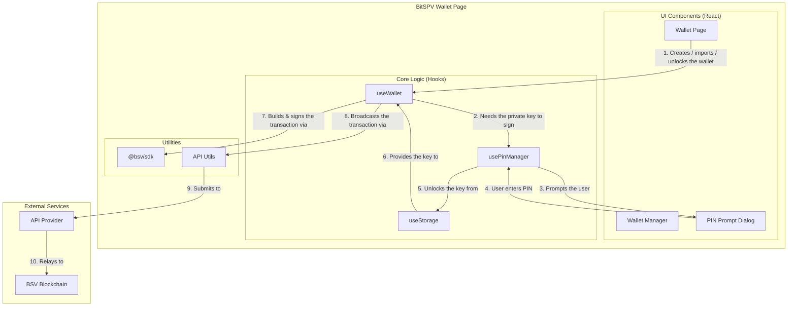

# BitSPV Pay

**Live Demo: https://pay.bitspv.com/**

A non-custodial BSV wallet that runs in your browser. Its distinguishing feature is the offline build: **one self-contained HTML file** you can checksum, pin to a release, and open on an air-gapped machine — no install, no app store, no network.

It supports legacy addresses and Paymail, and relies on public indexer services like `Whatsonchain` and `Bitails` for blockchain data.

If you only want the cold-storage path, download the offline build from [GitHub Releases](https://github.com/cyio/bitspv-pay/releases/latest) and read [Usage Scenarios → Cold Storage](#cold-storage-offline) first.

## Why a Web Wallet?

- **Long-term sustainability**: Native apps depend on app store approval, platform SDKs, and ongoing revenue to survive. A web wallet runs in any browser, has no gatekeepers, and can be maintained at near-zero cost — eliminating the risk of an abandoned app forcing users to migrate their funds.
- **Fast, native QR scanning**: Uses the browser-native BarcodeDetector API where available, delegating barcode parsing to the OS-level implementation — significantly faster than any JS library, with zero bundle overhead. This has been one of the key advantages of this project from the start.
- **Auditable offline signer**: The cold path is a single HTML file, so "what actually signs my transaction" is a file you can hash and compare across releases — something a native binary makes much harder.

## Usage Scenarios

### Cold Storage (Offline)

For securing larger amounts. Download the offline single-file build and pin it to a specific release — it will never auto-update. Create or import your wallet on an air-gapped device; use a watch-only wallet on your online device and sign transactions via QR code. Back up both the encrypted wallet file and the offline HTML together so the wallet remains self-contained and independently recoverable.

### Hot Wallet (Daily Use)

Suitable for small, everyday payments where some risk is acceptable. Access the hosted version directly — no installation required. At signing time, the app decrypts the private key locally and signs the transaction on-device; the key never leaves the browser.

> Store only what you can afford to lose. Browser data loss, device theft, or a missed backup can be unrecoverable.

## Features

- **Offline Single-file Build**: A self-contained HTML build for cold wallet use — no network required after download. This is the part you can verify and pin.
- **Watch-only Wallet & Air-gap Signing**: Add a watch address without a private key, then sign transactions offline via QR code on an air-gapped device.
- **Runtime Security Self-Check**: Built-in diagnostics in the log console that surface the CSP outbound allowlist, a change-detecting allowlist fingerprint, and integrity/version checks.
- **Non-custodial**: Users have full control of their private keys, which are stored locally.
- **Send & Receive**: Supports both legacy BSV addresses and Paymail.
- **Standalone Wallet**: Send, receive, back up, and monitor balances in the browser — nothing external calls into it.
- **Lightweight & Focused**: A small interface for core wallet tasks.
- **Internationalization**: Multi-language support.


## Security

Security is layered — no single mechanism is trusted on its own. See [docs/security.md](./docs/security.md) for the full picture.

- **Non-custodial, locally encrypted keys**: The private key is encrypted with a user PIN (PBKDF2 + AES-GCM) and stored only in the browser; it is decrypted locally at signing time and never leaves the device. Details and threat model: [docs/pin-security.md](./docs/pin-security.md).
- **Strict CSP network isolation**: A Content Security Policy (`connect-src` / `img-src` / `script-src`) restricts all outbound traffic to a small allowlist, so even an injected script cannot exfiltrate data to an arbitrary domain.
- **Runtime security self-check**: The built-in console exposes the *current* CSP outbound allowlist plus a SHA-256 **fingerprint** that changes whenever a domain is added or removed, and diffs it against an expected baseline shipped in the repo. Ordinary users get a one-glance “no risks / N items to review” summary; power users can copy the full report and pin the fingerprint across releases.
- **Air-gapped signing & offline build**: Keep the key on an offline device and sign via QR code; the offline single-file build needs no network after download.

## Tech Stack

- **Frontend Framework**: React
- **Build Tool**: Vite
- **Styling**: TailwindCSS
- **UI Component Library**: shadcn/ui
- **Wallet & Signing**: `@bsv/sdk` and `@bsv/paymail`
- **Internationalization**: `react-i18next`
- **State Management**: React Hooks

## Architecture Overview

This diagram illustrates the wallet flow: the page is opened directly by the user, the key is unlocked locally with a PIN, and the transaction is built, signed and broadcast in the browser.



**Key Business Logic:**

- **Wallet Management**:
    - Create, import, and back up the wallet.
    - Add a watch-only address (no private key) for monitoring balances.
    - Sign transactions offline via QR code for air-gapped cold wallet use.
    - Manually send BSV to legacy addresses or Paymail.
    - View transaction history.
- **Security**:
    - Private keys are encrypted with a user-defined PIN and stored in the browser's local storage.

## Removed: third-party payment-request entry

Earlier versions could be called from other sites as a payment handler — payment parameters came in the URL hash, and the result went back via `postMessage` or a `callbackUrl` redirect. **That entry point has been removed**: the page no longer reads payment parameters from the URL, never posts messages to `window.opener`, and never redirects to a `callbackUrl`.

Old links of the form `https://pay.bitspv.com/#<paymentParams>` now show a one-time notice and load as a normal wallet. The historical protocol is documented in [docs/pay_html_integration.md](./docs/pay_html_integration.md) for reference only.

**Why it was removed, not deprecated:** that contract cannot be honoured by a pure front-end. A `payment_success` message only proves *this window said so* — `event.source` checks the sender window, not the payment: anything running in that page (devtools, a compromised extension, one XSS) can forge it. The `callbackUrl` redirect is weaker still, since `?status=success&data=<txid>` is a URL the user can type. And what the wallet actually knows is "a transaction was broadcast", not "it confirmed, for the right amount, to the right address".

So don't build on this page: **no amount of front-end checking turns its output into proof of payment.** If you need a trustworthy result you need a server that verifies the txid on-chain against an idempotent order id — that's a payment gateway, which is a different product with a different trust model.

## Tools

- **[Wallet Backup Decryption Tool](https://cyio.github.io/bitspv-open/wallet-decrypt/)**: A standalone tool to decrypt exported wallet backups.

## Development and Deployment

### Local Development

1.  **Install dependencies**:
    ```bash
    pnpm install
    ```
2.  **Run the development server**:
    ```bash
    pnpm dev
    ```
    The application will run at `http://localhost:5173` (or a similar address).

### Building for Production

```bash
pnpm build
```
The build artifacts will be located in the `dist/` directory.

### Offline Single-file Build (Cold Wallet)

```bash
pnpm build:offline
```
Produces a self-contained HTML file with no external dependencies, suitable for use on an air-gapped device.

## Contributing

Contributions to this project are welcome! If you have any feature suggestions, bug reports, or improvements, please feel free to submit a Pull Request or Issue.

## License

This project is licensed under the Open BSV License.
